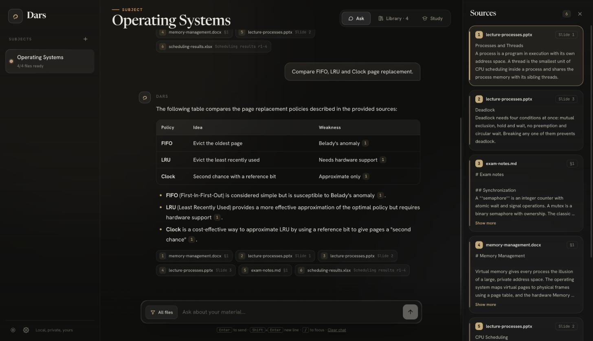
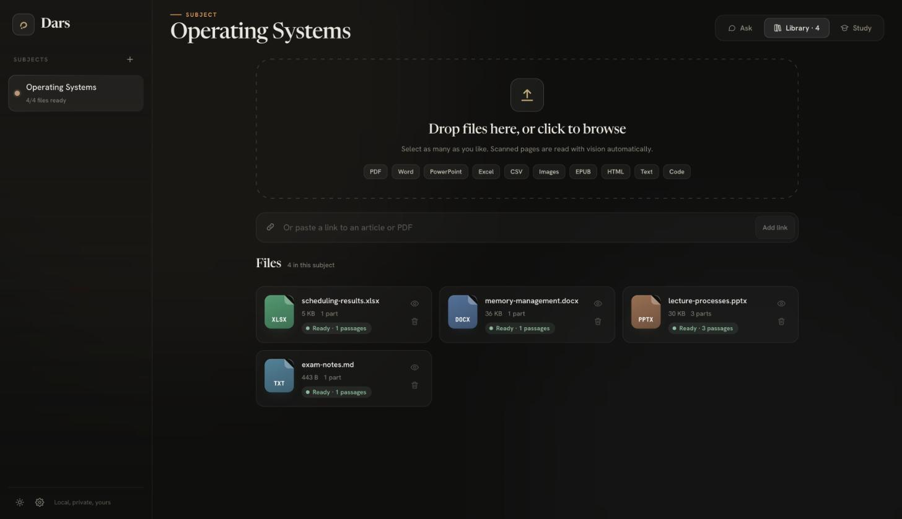
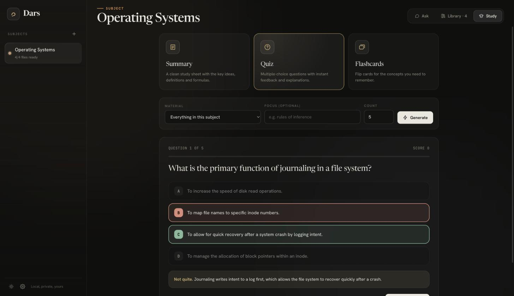
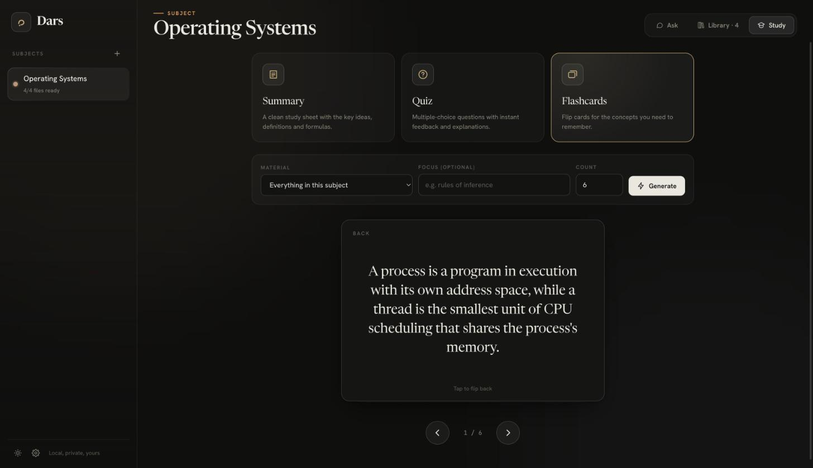
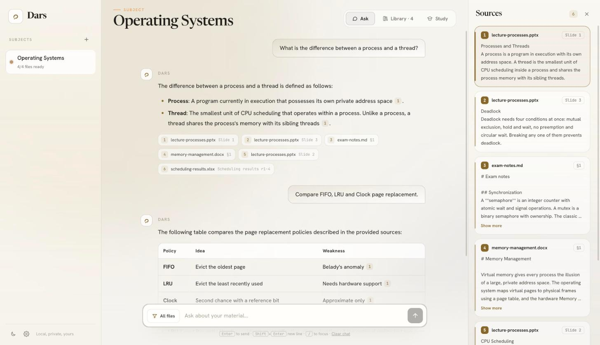

<p align="center"></p>

# Dars

An AI study assistant that reads your course material and answers from it, with the exact file and page for every claim.

Drop in lecture slides, scanned notes, spreadsheets or web pages, ask questions in any language, and get cited answers, summaries, quizzes and flashcards built only from your own files.



## Features

- **Reads many formats**: PDF (text or scanned), Word, PowerPoint, Excel, CSV, EPUB, HTML, images, plain text, Markdown, JSON and source code, plus links to articles or PDFs.
- **Cited answers**: every answer carries numbered references. Click one to see the exact passage, file and page or slide.
- **Hybrid retrieval**: semantic vector search fused with SQLite FTS5 keyword search using reciprocal rank fusion.
- **Cheap OCR for scans**: several scanned pages are stitched into one image and read in a single request. The number of pages per request is a setting.
- **Study tools**: structured summaries, multiple-choice quizzes with explanations, and flip flashcards.
- **Multi-language**: replies follow the language of your question, including Arabic with right-to-left rendering.
- **Subjects**: keep each course in its own workspace with its own files and chat history.
- **Local first**: files, index and history live in a local SQLite database. Only the text and page images needed for a request are sent to the Gemini API.

## Screenshots

| | |
| --- | --- |
| <br>**Library**: drop in any mix of files and watch them get indexed. | <br>**Quiz**: questions built from your own material, with explanations. |
| <br>**Flashcards**: flip cards for the concepts worth memorizing. | <br>**Light theme**: same interface, paper-like palette. |

## Stack

| Layer | Tech |
| --- | --- |
| API | Python, FastAPI, Uvicorn |
| Storage | SQLite with FTS5, embeddings stored as float32 blobs, NumPy cosine search |
| Models | Gemini through its OpenAI-compatible endpoint (chat, vision OCR, embeddings) with multi-key rotation and cooldowns |
| Parsing | PyMuPDF, python-docx, python-pptx, openpyxl, BeautifulSoup |
| UI | React 18 (hooks, context, portals, `useDeferredValue`) with htm, Tailwind CSS, no build step |

## Quick start

You need Python 3.10 or newer and a free Gemini API key.

**1. Get a Gemini API key**

1. Open [Google AI Studio](https://aistudio.google.com/apikey) and sign in with a Google account.
2. Click **Create API key** and pick (or create) a project.
3. Copy the key. The free tier is enough for personal study use.

Each key has its own rate limit, so you can create a few keys (from different projects) and Dars will rotate between them automatically.

**2. Install**

```bash
git clone https://github.com/tr4cex/dars.git
cd dars
pip3 install -r requirements.txt
cp .env.example .env
```

**3. Add your key**

Open `.env` and replace the placeholder. Separate several keys with commas:

```
GEMINI_API_KEYS=AIza...your_first_key,AIza...your_second_key
```

**4. Run**

```bash
./run.sh
```

Open http://localhost:8000, create a subject, drop in a file and start asking. To use another port run `PORT=9000 ./run.sh`.

React, htm and Tailwind are vendored in `frontend/assets/vendor`, so the interface works offline. Fonts and math rendering (KaTeX) load from a CDN and degrade gracefully without it.

**Troubleshooting**

- `429` or "quota" errors: you hit a key's rate limit. Wait a minute or add more keys.
- A file stays on "Failed": open the Library, check the message on the card and press retry. Scanned PDFs need a working key because pages are read with vision.
- `Address already in use`: another program is using the port, start Dars with a different `PORT`.

## Configuration

| Variable | Default | Purpose |
| --- | --- | --- |
| `GEMINI_API_KEYS` | none | Comma separated API keys, rotated automatically |
| `DARS_CHAT_MODEL` | `gemini-3.1-flash-lite` | Answers, summaries, quizzes |
| `DARS_VISION_MODEL` | `gemini-3.1-flash-lite` | OCR for scans and images |
| `DARS_EMBED_MODEL` | `gemini-embedding-001` | Passage and query embeddings |

In the app, open Settings to change how many scanned pages are merged per OCR request (1 to 8) and the render sharpness of scans.

## How it works

```
upload  ->  extract text per page/slide/sheet  ->  scanned pages? stitch N pages -> vision OCR
        ->  chunk (about 1000 chars, overlap)  ->  embed  ->  SQLite (chunks + FTS5)

question -> embed query -> top 30 vectors + top 30 keyword hits -> reciprocal rank fusion
         -> top 8 passages -> numbered sources + question -> streamed answer with [n] citations
```

Page splitting for stitched OCR relies on `=== PAGE k ===` markers in the model output. If a response does not contain all markers, those pages are transparently re-read one by one.

## API

| Method | Path | Description |
| --- | --- | --- |
| GET | `/api/collections` | List subjects |
| POST | `/api/collections` | Create a subject |
| POST | `/api/collections/{id}/upload` | Upload one or more files |
| POST | `/api/collections/{id}/url` | Add a web page or PDF by link |
| GET | `/api/collections/{id}/documents` | Files with indexing progress |
| POST | `/api/collections/{id}/chat` | Streamed answer (NDJSON events: `sources`, `tok`, `end`) |
| POST | `/api/collections/{id}/study` | `summary`, `quiz` or `flashcards` |
| GET / PUT | `/api/settings` | OCR batching and sharpness |

## Project layout

```
backend/
  app.py          FastAPI routes
  rag.py          ingestion, hybrid retrieval, answers, study tools
  extractors.py   one extractor per file type
  llm.py          key pool, embeddings, chat, vision OCR and page stitching
  chunker.py      sentence-aware chunking
  db.py           SQLite schema and helpers
frontend/
  index.html
  assets/js/      React app (store, components, markdown renderer)
  assets/vendor/  React, htm, Tailwind
```

## Privacy

Your files and the database stay on your machine in `data/`, which is git-ignored. Requests to the Gemini API contain the passages or page images needed to answer or read them. Keep your `.env` out of version control.

## License

MIT
